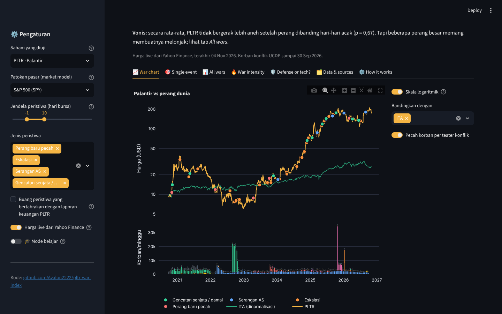
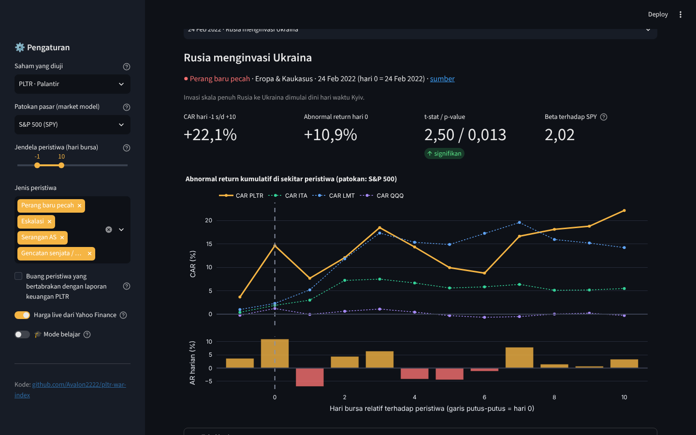
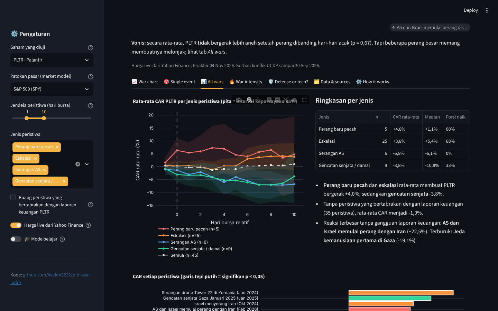
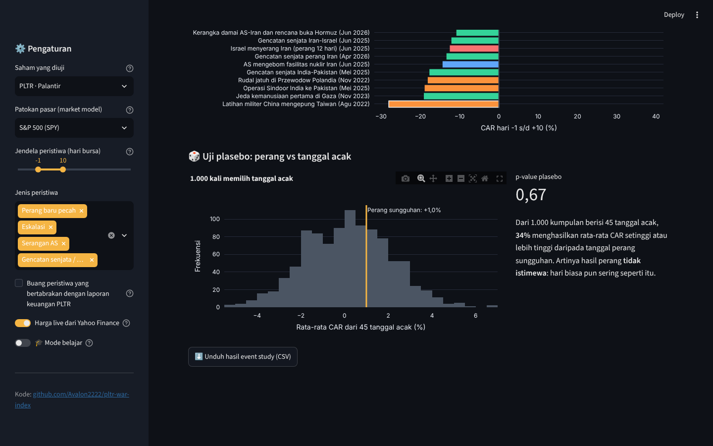
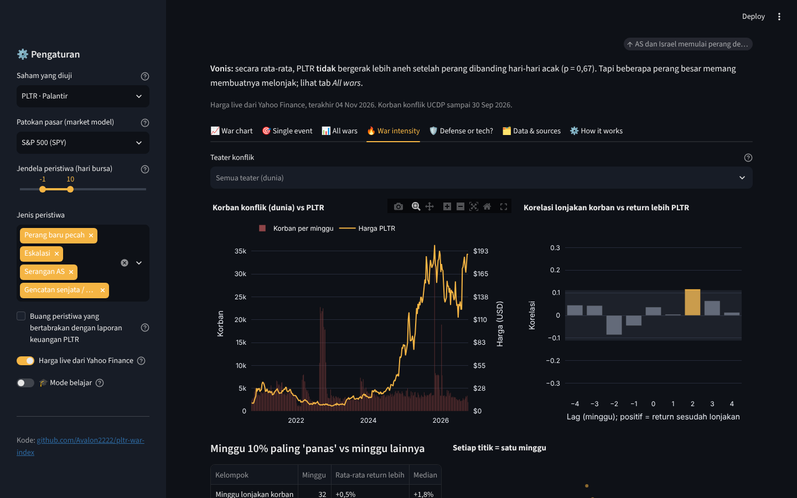
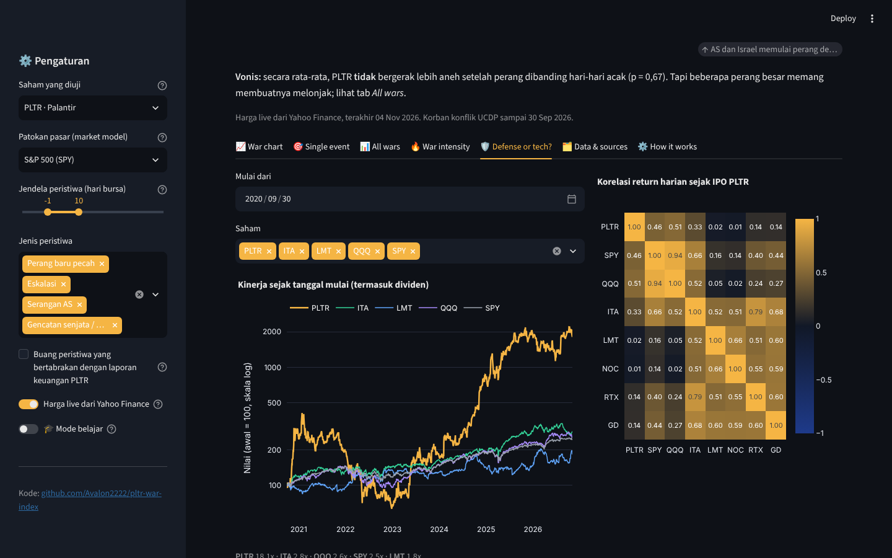
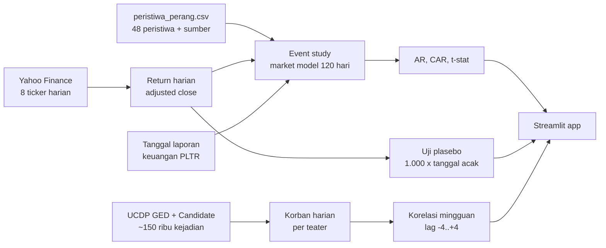

# 🛰️ PLTR War Index

[](https://github.com/Avalon2222/pltr-war-index/actions/workflows/tests.yml) [](https://www.python.org/) [](LICENSE) [](https://pltr-war-index.streamlit.app)

> **Does war pay?** Saham Palantir (PLTR) diuji dengan **event study** terhadap 48 peristiwa perang, eskalasi,
> serangan AS, dan gencatan senjata sejak IPO 2020, lalu disandingkan dengan korban konflik harian dari **UCDP**.
> Apakah PLTR benar-benar "saham perang", atau pasar hanya melihatnya sebagai saham AI? Dibangun dengan Python,
> pandas, NumPy, Plotly, dan Streamlit.

## 🇬🇧 In English

**Every war has a ticker. Is Palantir's one of them?** A finance-grade event study of Palantir stock around 48
hand-curated war events (invasions, escalations, US strikes, ceasefires) from its 2020 IPO to 2026, using a market
model, abnormal returns, t-tests, and a 1,000-draw placebo test against random dates. Then a weekly cross-check
against UCDP conflict deaths, and a head-to-head with Lockheed Martin, Northrop, RTX, and the defense ETF.

- **Pick** any event (Russia invades Ukraine, the 2026 Iran war, the Gaza ceasefire) and see PLTR's cumulative abnormal return next to ITA, LMT, and QQQ.
- **Average** every war by category, with 95% confidence bands, and see whether it beats random days.
- **Flag** events that collide with Palantir earnings, the biggest confounder in the data.
- **Correlate** weekly conflict deaths with PLTR's excess return across ±4 week lags.

**Built with:** Python, pandas, NumPy, Plotly, Streamlit  
**Data:** Yahoo Finance daily prices (8 tickers), UCDP GED 26.1 + Candidate 2026 conflict deaths, a curated event list with a source link for every row  
**Engineering:** Pure, tested event-study module (25 pytest tests), weekly GitHub Actions data refresh, live price fetch with snapshot fallback, learning mode

*The rest of this README is in Indonesian.*

**🚀 Coba langsung di browser:** [pltr-war-index.streamlit.app](https://pltr-war-index.streamlit.app)



> ℹ️ **Disclaimer.** Ini proyek analisis data untuk edukasi, **bukan saran investasi**, dan tidak berafiliasi dengan
> Palantir Technologies. Daftar peristiwa dikurasi manual; setiap baris punya tautan sumber yang bisa diperiksa.

## Latar belakang

Palantir lahir dari dunia intelijen: salah satu investor awalnya In-Q-Tel, lengan investasi CIA. Perangkat lunaknya
dipakai militer AS, NATO, dan Ukraina, dan CEO-nya sering menyebut misi perusahaan adalah membantu Barat unggul,
termasuk di medan perang. Setiap
kali konflik besar pecah, linimasa ramai dengan klaim yang sama: *"PLTR pasti terbang."* Klaim itu jarang dicek balik.

Proyek ini mengujinya dengan cara yang dipakai di jurnal keuangan: **event study**. Untuk setiap peristiwa, kita hitung
berapa return PLTR yang "seharusnya" terjadi berdasarkan gerakan pasar, lalu ukur selisihnya. Kalau perang memang
menguntungkan Palantir, selisih itu (abnormal return) harus positif dan lebih besar daripada hari-hari biasa.

## Apa yang terlihat dari data

Dengan pengaturan default (jendela hari −1 s/d +10, patokan S&P 500):

| Temuan | Angka |
|---|---|
| Rata-rata CAR PLTR di 45 peristiwa yang datanya cukup | **+1,0%**, tidak berbeda dari tanggal acak (p plasebo = 0,67) |
| Perang baru pecah + eskalasi (30 peristiwa) | rata-rata **+4,0%**, 67% naik (p plasebo ≈ 0,12, belum signifikan) |
| Gencatan senjata / damai (9 peristiwa) | rata-rata **−3,8%**, hanya 33% naik |
| Rusia menginvasi Ukraina (24 Feb 2022) | **+22,1%**, p = 0,013 |
| AS dan Israel memulai perang dengan Iran (28 Feb 2026) | **+22,5%**, p = 0,014 |
| Tanpa peristiwa yang bertabrakan dengan laporan keuangan (35 peristiwa) | rata-rata turun menjadi **−1,0%** |
| Korelasi return harian PLTR sejak IPO | QQQ **0,51**, ETF pertahanan ITA **0,33**, Lockheed Martin **0,02** |
| Kinerja sejak IPO (termasuk dividen) | PLTR **18,1x**, ITA 2,8x, QQQ 2,6x, S&P 500 2,5x, LMT 1,8x |

Ringkasnya: **pasar memperlakukan Palantir sebagai saham software/AI, bukan kontraktor senjata.** Rata-rata perang
tidak membuatnya bergerak aneh. Tapi dua perang terbesar dalam data (invasi Ukraina 2022 dan perang Iran 2026) memang
diikuti lonjakan lebih dari 20% di atas pasar, dan pola "naik saat perang, turun saat damai" terlihat walau belum cukup
kuat untuk disebut bukti. Beberapa lonjakan yang paling besar (Tower 22 Januari 2024, serangan Israel ke Iran Oktober
2024) ternyata bertepatan dengan laporan keuangan PLTR, yang sering membuat sahamnya naik 20-30% dalam sehari.

## Fitur

| Tab | Isi |
|---|---|
| 📈 War chart | Harga PLTR (skala log) dengan titik setiap peristiwa berwarna menurut jenisnya, pembanding yang dinormalisasi, dan batang korban konflik mingguan per teater (Rusia-Ukraina, Israel-Gaza-Lebanon, Iran, Sudan, ...) |
| 🎯 Single event | Pilih satu peristiwa: CAR PLTR vs ITA, LMT, QQQ, abnormal return harian, t-stat, p-value, beta, peringatan bila laporan keuangan jatuh di jendela, tabel harian dan rumus market model |
| 📊 All wars | Rata-rata CAR per jenis peristiwa dengan pita kepercayaan 95%, CAR setiap peristiwa (yang signifikan diberi garis tepi), **uji plasebo** 1.000 kumpulan tanggal acak, unduh hasil |
| 🔥 War intensity | Korban mingguan UCDP vs harga, korelasi lonjakan korban dengan return lebih pada lag −4 s/d +4 minggu, minggu 10% "terpanas" vs lainnya, scatter per minggu |
| 🛡️ Defense or tech? | Kinerja relatif 8 ticker, matriks korelasi, korelasi bergulir 120 hari PLTR dengan ITA, LMT, dan QQQ |
| 🗂️ Data & sources | Daftar 48 peristiwa dengan tautan sumber, unduh semua CSV, tabel sumber data |
| ⚙️ How it works | Alur analisis langkah demi langkah dan keterbatasannya |
| 🎓 Mode belajar | Toggle di sidebar: setiap tab menampilkan penjelasan istilah |

Sidebar mengatur saham yang diuji (bisa diganti ke LMT atau ITA untuk perbandingan), patokan pasar (SPY, QQQ, ITA, atau
tanpa patokan), panjang jendela, jenis peristiwa, dan opsi membuang peristiwa yang bertabrakan dengan laporan keuangan.







## Cara menjalankan

```bash
git clone https://github.com/Avalon2222/pltr-war-index.git
cd pltr-war-index
python -m venv .venv && source .venv/bin/activate   # Windows: .venv\Scripts\activate
pip install -r requirements.txt
streamlit run app.py
```

Buka `http://localhost:8501`. Jalankan pengujian dengan `python -m pytest tests/ -v` (25 tes, tanpa internet).
Aplikasi mengambil harga terbaru dari Yahoo Finance bila terjangkau, dan memakai snapshot di `data/` bila tidak.

### Memperbarui data

```bash
python -m src.ambil_harga        # harga 8 ticker sejak 30 Sep 2020 (beberapa detik)
python -m src.siapkan_konflik    # unduh UCDP GED (39 MB zip) + Candidate terbaru, ringkas jadi korban harian
```

GitHub Actions (`.github/workflows/perbarui-data.yml`) menjalankan keduanya tiap Senin dan melakukan commit bila ada
perubahan. Peristiwa baru ditambahkan manual ke `data/peristiwa_perang.csv` (format di [data/SUMBER_DATA.md](data/SUMBER_DATA.md)).

## Cara kerja (ringkas)



1. **Hari 0** = hari bursa pertama pada atau setelah tanggal peristiwa (perang yang pecah hari Sabtu baru direspons Senin).
2. **Market model.** Regresi `R_PLTR = α + β × R_SPY` pada hari −130 s/d −11 sebelum peristiwa.
3. **Abnormal return** = return asli − (α + β × return pasar). Dijumlah menjadi **CAR** di jendela peristiwa.
4. **Uji t** per peristiwa: `t = CAR / (σ × √L)`. **Uji plasebo**: rata-rata CAR dari 1.000 kumpulan hari bursa acak.
5. **Intensitas.** Korban UCDP dijumlah per minggu, diubah ke perubahan log, dikorelasikan dengan return PLTR dikurangi pasar.

Penjelasan lengkap dengan contoh angka ada di [docs/BELAJAR.md](docs/BELAJAR.md).

## Data

| File | Isi | Sumber |
|---|---|---|
| `data/harga_saham.csv` | Harga harian PLTR, SPY, QQQ, ITA, LMT, NOC, RTX, GD sejak 30 Sep 2020 (close, adjusted close, volume) | [Yahoo Finance](https://finance.yahoo.com/quote/PLTR/) |
| `data/peristiwa_perang.csv` | 48 peristiwa 2020-2026: tanggal, jenis, kawasan, keterangan, tautan sumber | Kurasi manual (Wikipedia, CFR, media) |
| `data/konflik_harian.csv` | Korban harian kekerasan bersenjata per teater konflik, 2020 s/d Sep 2026 | [UCDP GED 26.1 + Candidate](https://ucdp.uu.se/downloads/) |
| `data/laporan_keuangan_pltr.csv` | 25 tanggal rilis laporan kuartalan PLTR | Kalender rilis publik, dicek dengan lonjakan volume |

Detail kolom, cara pembaruan, dan lisensi tiap sumber ada di [data/SUMBER_DATA.md](data/SUMBER_DATA.md).

## Keterbatasan

- **Pemilihan peristiwa itu subjektif.** 48 peristiwa ini dipilih karena besar dan ramai diberitakan. Daftar lain bisa
  memberi hasil lain; silakan tambah baris di CSV dan lihat apakah kesimpulannya berubah.
- **Peristiwa bertumpuk.** Serangan AS ke Iran (22 Juni 2025) dan gencatan senjata dua hari kemudian berada di jendela
  yang sama. Efeknya tidak bisa dipisahkan.
- **Pasar bisa tahu duluan.** Invasi Ukraina sudah diperingatkan berminggu-minggu. Geser jendela ke −10 untuk melihatnya.
- **PLTR sangat bergejolak.** Dengan simpangan baku harian sekitar 4%, hanya gerakan yang sangat besar yang bisa
  dibedakan dari kebetulan. Itulah alasan uji plasebo dipakai.
- **UCDP 2026 masih rilis awal** (Candidate) dan biasanya direvisi naik. GDELT dan ACLED tidak dipakai: GDELT DOC API
  membatasi permintaan dengan ketat, ACLED butuh akun.

## Struktur repositori

```
pltr-war-index/
├── app.py                       # UI Streamlit (7 tab + mode belajar)
├── src/
│   ├── studi_peristiwa.py       # event study: market model, AR/CAR, t-test, plasebo (murni, tanpa Streamlit)
│   ├── intensitas.py            # korban mingguan, korelasi lag, korelasi bergulir, kinerja relatif
│   ├── ambil_harga.py           # unduh harga dari Yahoo Finance
│   ├── siapkan_konflik.py       # unduh + ringkas UCDP GED/Candidate
│   └── muat_data.py             # baca CSV, harga live dengan cadangan snapshot
├── data/                        # snapshot CSV + SUMBER_DATA.md
├── tests/                       # 25 tes pytest
├── docs/
│   ├── BELAJAR.md               # panduan konsep dan kode
│   ├── LATIHAN.md               # latihan bertingkat
│   └── screenshots/
└── .github/workflows/           # tes + pembaruan data mingguan
```

## Belajar dari proyek ini

- [docs/BELAJAR.md](docs/BELAJAR.md): event study dari nol, market model, abnormal return, uji t, uji plasebo, dan
  cara membaca korelasi lag. Setiap konsep disertai potongan kode dari `src/`.
- [docs/LATIHAN.md](docs/LATIHAN.md): 8 latihan dari menambah peristiwa sampai membuat model Fama-French sederhana.

## Rencana pengembangan

- Tambah lapisan berita kontrak Palantir (Army, Maven, NHS, Ukraina) dari USAspending sebagai peristiwa pembanding.
- Model tiga faktor (pasar, teknologi, pertahanan) sebagai pengganti market model satu faktor.
- Data peristiwa harian ACLED untuk teater tertentu bila akses tersedia.
- Uji intraday untuk peristiwa yang terjadi saat bursa buka.

## Lisensi

MIT untuk kode. Data mengikuti lisensi sumbernya: UCDP (CC BY 4.0), harga Yahoo Finance hanya untuk keperluan
non-komersial dan edukasi.
